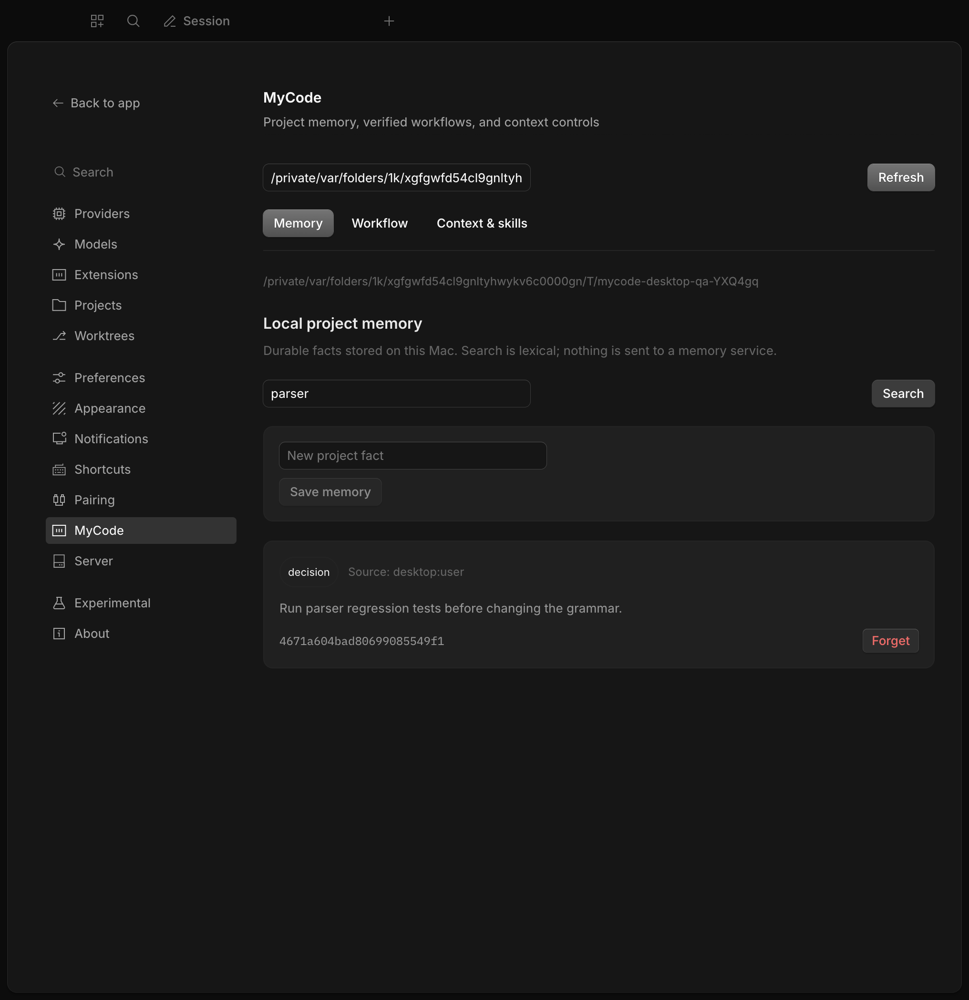
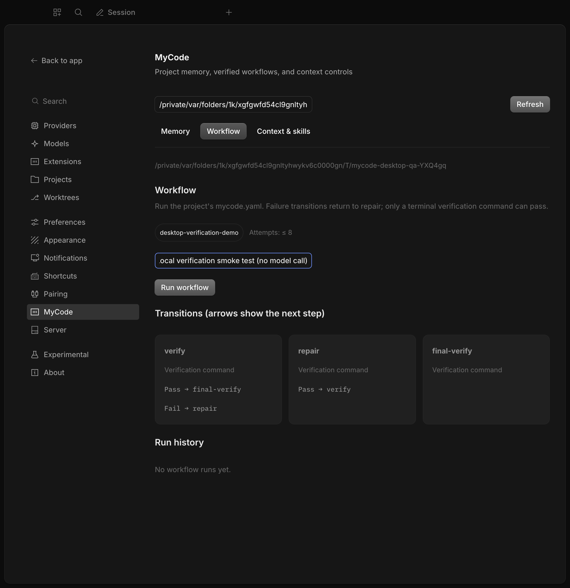
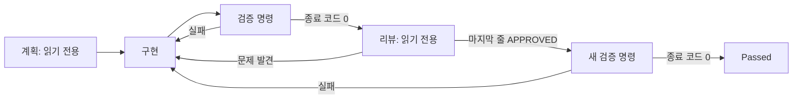
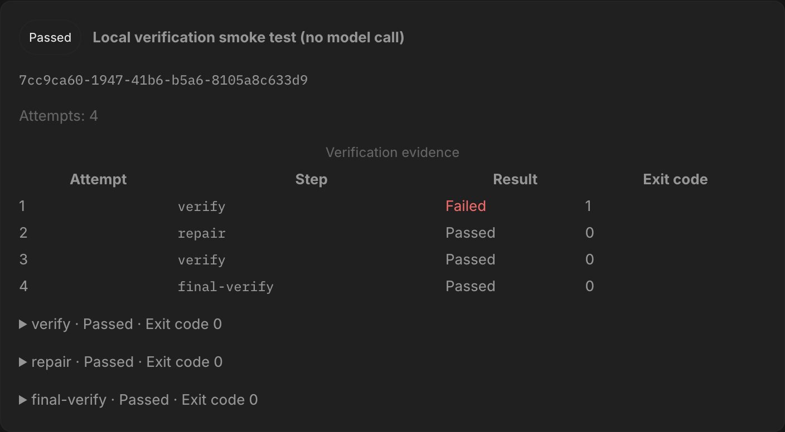
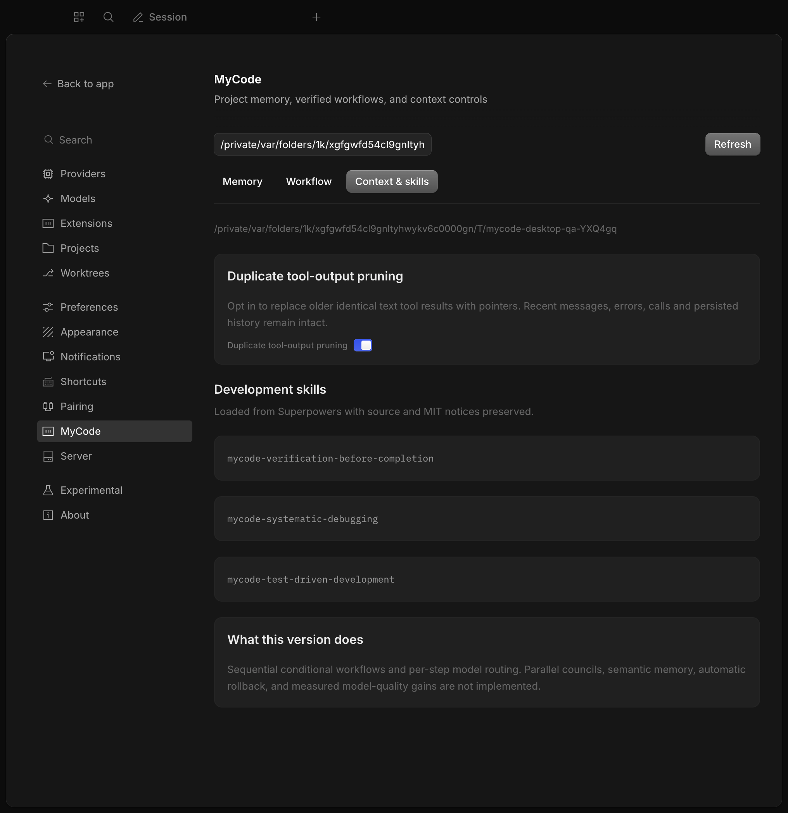

# MyCode

[OpenCode](https://github.com/anomalyco/opencode)를 기반으로 한 macOS 개발 앱입니다. **프로젝트 메모리**, **검증 조건에 따라 다음 단계가 바뀌는 워크플로**, **실행 이력**, **단계별 모델 선택**, **개발 스킬**을 추가합니다.

현재는 **0.1.0 개발 버전**입니다. 이 README의 이미지는 설치된 `/Applications/MyCode.app`에서 실제 기능을 조작한 화면입니다. 목업이나 생성 이미지가 아닙니다. 워크플로 예제 테스트는 모델 호출 없이 실제 로컬 명령으로 실행했습니다.

## Mac에 설치하기

**[Intel Mac용 MyCode DMG 다운로드](https://github.com/dykang/mycode/releases/download/v0.1.0-desktop.1/MyCode-0.1.0-x64.dmg)** · [릴리스와 체크섬](https://github.com/dykang/mycode/releases/tag/v0.1.0-desktop.1)

1. DMG를 열고 `MyCode.app`을 `Applications`에 복사합니다.
2. MyCode를 실행합니다.
3. 홈의 **Settings → MyCode**를 엽니다. macOS에서는 `⌘,`로 설정에 들어갈 수도 있습니다.
4. **Project directory**에 프로젝트의 절대 경로를 입력하고 **Load project**를 누릅니다.

이번 설치·화면 테스트 환경은 **Intel x64 / macOS 26.6.2**입니다. Apple Silicon용 패키징 경로는 있지만 이 릴리스에서 실기기 검증하지 않았습니다. 이 DMG는 Apple Developer 서명·공증을 받지 않은 개발 빌드입니다.

앱 ID는 `ai.dykang.mycode`입니다. 원본 OpenCode와 앱 데이터·서버 상태를 분리합니다. 이 개발 배포에서는 원본 OpenCode의 자동 업데이트와 URL 프로토콜 등록을 사용하지 않습니다. 앱 데이터는 `~/Library/Application Support/ai.dykang.mycode/`에 저장합니다.

## 실제 화면과 확인한 기능

### 프로젝트 메모리

**Memory**에서 규칙을 입력하고 **Save memory**를 누르면 프로젝트의 `.mycode/memory.sqlite`에 저장합니다. **Search**는 SQLite FTS5 기반 단어 검색입니다. 각 항목에서 내용, 종류, 출처, ID를 확인하고 **Forget**으로 해당 항목만 삭제할 수 있습니다.



실제 UI 테스트에서 저장, 검색, 삭제, 다른 프로젝트로 전환했을 때의 격리, 원래 프로젝트로 돌아왔을 때의 유지까지 확인했습니다. GUI에서 저장하는 항목은 `decision`이며, CLI에서는 `convention`, `failure`, `preference`도 지정할 수 있습니다.

새 모델 요청에서는 최근 사용자 메시지와 관련된 메모리를 최대 5개, 기본 6,000자 한도 안에서 주입합니다. 모델 도구는 `mycode_memory_search`, `mycode_memory_save`, `mycode_memory_forget`입니다. 모델의 읽기·쓰기에는 OpenCode의 `read`/`edit` 권한 검사를 적용합니다. 데스크톱에서 직접 누른 저장·삭제는 인증된 로컬 서버를 통한 사용자 작업입니다.

메모리 전용 외부 서비스나 API 키가 필요하지 않습니다. 모델에 회상된 내용은 선택한 모델의 요청에 포함됩니다. 로컬 DB는 암호화하지 않으며, 현재 검색은 의미 기반 검색이나 임의 부분 문자열 검색이 아닙니다. 대화 전체를 자동 저장하지도 않습니다.

### 동적 워크플로와 단계별 모델

**Workflow**는 프로젝트의 `mycode.yaml`을 읽습니다. 단계 카드에서 에이전트·모델과 성공·실패 시 이동할 단계를 확인합니다. 작업을 입력하고 **Run workflow**를 누릅니다. **Refresh**로 최신 진행 상태와 결과를 불러옵니다.



기본 개발 흐름은 다음과 같습니다. 화살표는 다음 실행 단계를 뜻합니다.



각 에이전트 단계에 `model: provider/model-id`를 지정하면 역할마다 다른 모델을 사용합니다. 생략하면 사용자가 OpenCode에서 선택한 모델을 따릅니다. 실패 시 다른 모델을 사용하는 수정 단계로 이동하도록 구성할 수도 있습니다. 현재 실행은 순차 방식이며, 여러 모델이 병렬로 협의하는 council은 구현하지 않았습니다.

| 설정                      | 의미                                                                |
| ------------------------- | ------------------------------------------------------------------- |
| `type: agent`             | OpenCode 에이전트 세션 실행. `agent`, `prompt`, 선택적 `model` 지정 |
| `type: command`           | 명령과 인자를 배열로 실행. 셸을 자동으로 거치지 않음                |
| `onSuccess` / `onFailure` | 성공·실패 결과에 따라 이동할 단계                                   |
| `maxVisits`               | 한 단계의 최대 완료 횟수. 기본 3회                                  |
| `timeoutMs`               | 한 실행의 제한 시간. 기본 900,000ms                                 |
| `maxSteps`                | 실행 오류 후 재개를 포함한 전체 실행 시도 한도. 기본 20회           |
| `promise`                 | 에이전트 출력 마지막 줄의 정확한 완료 표식 검사                     |

실행 전에 중복 ID, 존재하지 않는 이동 대상, 도달할 수 없는 단계, 검증 명령이 없는 종료 경로를 거부합니다. 모델이 성공했다고 말하거나 프로세스가 종료됐다는 사실만으로 `Passed`가 되지 않습니다. OpenCode 오류 이벤트와 불완전한 응답도 실패로 처리합니다. 마지막 검증 명령이 성공해야 종료할 수 있습니다.

### 하네스: 실패·복구·재검증의 증거

하네스는 단계를 실행하고 기록하며, 다음 단계와 종료 여부를 결정하는 실행 코드입니다. 아래는 실제 `/bin/test`가 실패한 뒤 `/usr/bin/touch`로 테스트 파일을 만들고, 검증을 다시 실행해 통과한 화면입니다.



이 예제는 **상태 전환과 종료 판정을 확인하는 로컬 smoke test**입니다. AI가 코드를 수정한 성공 사례나 모델 품질 비교 실험으로 해석하면 안 됩니다.

각 실행은 `.mycode/runs/<run-id>/`에 다음 파일을 남깁니다.

| 파일                                  | 확인할 수 있는 것                                      |
| ------------------------------------- | ------------------------------------------------------ |
| `state.json`                          | 작업, 워크플로 스냅샷, 대기 단계, 실행 횟수, 최신 결과 |
| `trace.jsonl`                         | 시작·종료·각 시도의 단계·성공 여부·종료 코드           |
| `<attempt>-<step>.stdout` / `.stderr` | 실제 프로세스의 원본 출력                              |

중단·실행 오류 후 재개할 수 있는 경우 화면에 **Resume**을 표시합니다. 실행 중에는 **Stop**을 사용할 수 있습니다. 이미 통과한 실행을 재개하면 다시 실행하지 않습니다. 반복 한도를 소진하거나 재개할 단계가 없는 경우 새 실행이 필요합니다.

재개는 현재 단계를 다시 수행할 수 있으므로 외부 부작용의 정확히 한 번 실행을 보장하지 않습니다. 타임아웃은 실행한 프로세스를 종료하지만, 임의의 사용자 명령이 따로 생성한 모든 자식 프로세스 종료까지 보장하지는 않습니다.

### 컨텍스트 정리와 개발 스킬

**Context & skills**에서 중복 출력 정리를 프로젝트별로 켜고 끌 수 있습니다. 기본값은 **Off**이며 설정은 `.mycode/context.json`에 저장합니다. 실제 UI 테스트에서 켜기, 파일 저장, 프로젝트별 분리와 재선택 후 유지를 확인했습니다.



정리 대상은 오래된 동일한 성공 텍스트 도구 결과입니다. 이를 더 최근 결과의 호출 ID를 가리키는 짧은 문장으로 바꿉니다. 최근 메시지, 오류, 도구 호출과 ID, 비텍스트 결과, 제공자 관리 결과는 보존합니다. 저장된 대화 이력은 수정하지 않고 모델에 보낼 요청만 바꿉니다. 토큰 절감량은 아직 측정하지 않았습니다.

다음 Superpowers 스킬을 실제 플러그인에 등록합니다.

- `mycode-verification-before-completion`: 완료 주장 전에 새 검증 증거 확인
- `mycode-systematic-debugging`: 증상 수정 전에 원인 조사
- `mycode-test-driven-development`: 동작 변경 전에 실패하는 회귀 테스트 작성

스킬은 모델에게 제공하는 개발 지침입니다. 화면에 로드됐다는 사실이 매 작업의 준수를 보장하지는 않습니다. 원본 스킬의 지원 파일, MIT 고지, 소스 커밋을 함께 보존했습니다.

## CLI와 소스에서 실행하기

필수 런타임은 루트 `packageManager`에 고정된 **Bun 1.4.4**입니다.

```sh
git clone https://github.com/dykang/mycode.git
cd mycode
git switch mycode-foundation
bun install
bun mycode doctor
bun mycode ui
```

다른 프로젝트에서는 다음과 같이 시작합니다.

```sh
bun mycode init --project /absolute/path/to/project
# 생성한 mycode.yaml의 검증 명령과 모델을 프로젝트에 맞게 확인합니다.
bun mycode run "빈 입력을 처리하도록 parser를 수정하고 회귀 테스트를 통과시켜줘" --project /absolute/path/to/project
bun mycode status --project /absolute/path/to/project
bun mycode resume <run-id> --project /absolute/path/to/project
```

```sh
bun mycode memory add "문법을 바꾸기 전에 parser 회귀 테스트를 실행한다" --kind convention
bun mycode memory search parser
bun mycode memory list
bun mycode memory forget <memory-id>
```

`init`은 기존 파일을 덮어쓰지 않습니다. 이 저장소의 기본 검증은 새 패키지용 `bun run mycode:check`입니다. 원본 패키지까지 바꾸는 작업에서는 `bun run check`와 관련 테스트를 포함하도록 검증 명령을 확장해야 합니다. 모델을 쓰는 단계는 사용자가 구성한 제공자 인증이 필요합니다.

`.mycode/`에는 작업 문구·메모리·명령 출력이 들어갑니다. 이 포크에서는 gitignore 처리하며 다른 프로젝트에서도 제외해야 합니다. 프로젝트 루트를 일관되게 지정하세요. CLI의 현재 디렉터리와 데스크톱이 인식한 Git 프로젝트 루트가 다르면 서로 다른 데이터를 보게 될 수 있습니다.

## 직접 빌드하고 검증하기

```sh
bun run mycode:check
bun run --cwd packages/mycode typecheck:tsc
bun run --cwd packages/mycode build
bun run check
bun run lint:changed
```

macOS DMG를 만들려면:

```sh
bun run mycode:dmg
# 현재 Mac 아키텍처의 CLI, 플러그인, Electron 앱, DMG를 함께 빌드합니다.
```

실제 설치 앱의 UI 테스트를 다시 실행하려면 MyCode를 localhost 디버깅 포트로 열고 다음 명령을 실행합니다. 테스트는 임시 Git 프로젝트를 만들며 유료 모델 API를 호출하지 않습니다.

```sh
open -a /Applications/MyCode.app --args --remote-debugging-port=9463
node packages/mycode/script/desktop-qa.mjs
```

스크립트는 메모리 저장·검색·삭제·프로젝트 격리, 복구 워크플로의 실제 종료 코드, 컨텍스트 옵션 저장, 개발 스킬 표시를 확인하고 `docs/images/`의 스크린샷을 갱신합니다. 상세 실행 보고서는 `.mycode/desktop-qa.json`에 저장합니다. 검증 기록과 범위는 [데스크톱 테스트 기록](docs/desktop-validation.md)에 정리합니다.

## 원본 프로젝트와 실제 채택 범위

기능 이름이 비슷하다는 이유로 전체 프로젝트를 통합했다고 표현하지 않습니다. 직접 가져온 코드·지침과 설계 참고를 아래처럼 구분합니다.

| 원본                                                                                                        | MyCode에 반영한 것                     | 채택 형태                                                                           |
| ----------------------------------------------------------------------------------------------------------- | -------------------------------------- | ----------------------------------------------------------------------------------- |
| [anomalyco/opencode](https://github.com/anomalyco/opencode)                                                 | CLI·서버·TUI·Electron 데스크톱 기반    | 실제 GitHub 포크. MIT. 기준 `7d5b72250890e0e89573b4cab42a003a48c20567`, `dev` 2.2.5 |
| [obra/superpowers](https://github.com/obra/superpowers)                                                     | 검증·디버깅·TDD 스킬과 지원 파일       | MIT 원문을 포함하고 플러그인 이름·상호 참조를 연결                                  |
| [Th0rgal/open-ralph-wiggum](https://github.com/Th0rgal/open-ralph-wiggum)                                   | 마지막 줄의 엄격한 완료 표식 검사      | MIT 코드 일부 재사용. 외부 Ralph CLI 전체를 포함하지 않음                           |
| [Tlahey/harness](https://github.com/Tlahey/harness)                                                         | 선언형 단계, 반복 한도, 실행 추적 설계 | 스키마 개념을 조건부 상태 기계로 맞춰 구현. 원본 runner·memory 코드를 복사하지 않음 |
| [alvinunreal/oh-my-opencode-slim](https://github.com/alvinunreal/oh-my-opencode-slim)                       | 역할별 모델 라우팅 구조                | 설계 참고. scheduler·council·background agent 코드는 포함하지 않음                  |
| [supermemoryai/opencode-supermemory](https://github.com/supermemoryai/opencode-supermemory)                 | 범위별 회상과 제한된 컨텍스트 주입     | 설계 참고. 별도 로컬 SQLite 구현이며 원격 백엔드·SDK는 포함하지 않음                |
| [Tarquinen/opencode-dynamic-context-pruning](https://github.com/Tarquinen/opencode-dynamic-context-pruning) | 컨텍스트 관리 문제의 참고              | AGPL 원본 코드·의존성은 포함하지 않음. 중복 결과 처리는 독립 구현                   |
| [code-yeongyu/oh-my-openagent](https://github.com/code-yeongyu/oh-my-openagent)                             | 확장 방향 검토                         | Sustainable Use License 원본 코드·런타임은 포함하지 않음                            |

커밋 고정값은 [sources.json](packages/mycode/sources.json), 고지와 자세한 경계는 [THIRD_PARTY.md](packages/mycode/THIRD_PARTY.md), 보존된 고지는 [third-party](packages/mycode/third-party/)에서 확인할 수 있습니다. 원본 OpenCode 문서는 [README.upstream.md](README.upstream.md)에 보존했습니다.

## 아직 검증하지 않았거나 구현하지 않은 것

실제 앱 설치와 로컬 기능 테스트는 모델 품질·비용·장기 작업 성공률 개선을 입증하지 않습니다. 병렬 council, 의미 기반 메모리, 프로젝트 간 자동 동기화, 자동 코드 롤백, 평가 기반 자기 개선은 후속 작업입니다. [로드맵](packages/mycode/ROADMAP.md)을 참고하세요.
