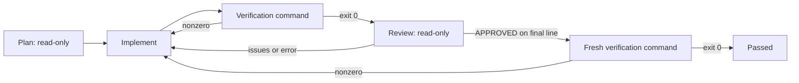

# mycode

An experimental development layer in [dykang/mycode](https://github.com/dykang/mycode), forked from OpenCode.
This first increment adds working project memory and a bounded workflow harness. It does not claim a measured
model-quality, token-cost, or task-success improvement over upstream.

## Run

Requires **Bun 1.4.4**, as pinned by the root package manager field.

```sh
git clone https://github.com/dykang/mycode.git
cd mycode
git switch mycode-foundation
bun install
bun mycode doctor
bun mycode ui
```

`mycode ui` starts the fork's normal OpenCode TUI with the memory plugin on a private server. Provider authentication is OpenCode's
normal login flow. There is no bundled API key or paid memory service. Model calls require your configured provider.

```sh
# From the fork root; --project works with every command.
bun mycode memory add "Run parser regression tests before changing the grammar" --kind convention
bun mycode memory search "parser"
bun mycode run "Fix the parser's handling of empty input"
bun mycode status
bun mycode resume <run-id>
```

For another repository:

```sh
bun mycode init --project /path/to/project
# Inspect mycode.yaml and set the project's real verification command before running.
bun mycode run "Implement the requested feature" --project /path/to/project
```

`init` refuses to replace an existing workflow. `ui` and `run` add a plugin through an inline OpenCode config overlay;
existing project/global settings remain loaded. Private servers ensure the plugin overlay applies to this invocation.
`--opencode /path/to/opencode` can select another compatible **v2** host.
The checked-in workflow runs `bun run mycode:check`, which validates this new package. Use the root `bun run check`
for whole-fork lint/type validation. Set a broader verification command for changes to other upstream packages.

## How the workflow works

Arrows mean “run this next when the labeled result is observed.”



The harness is the code that runs steps, records outcomes, and decides whether to continue. Each agent step uses
an OpenCode session and keeps the host's permission checks. Verification commands run directly as the current user,
exactly as configured, without a shell. Review is an advisory model check; the final command is the completion gate.
A passing command is only as useful as the checks you configure.

For example, if tests exit 1, the next implementation prompt contains the failed test output. After repair, tests
run again, followed by review and a fresh final check. If the repair keeps failing, the visit/step budget ends the run
as `failed`. A claim of success in model text cannot override a failing command or an OpenCode error event.

Workflow configuration is YAML or JSON. Each step defines `onSuccess`, optional `onFailure`, `maxVisits`, and
`timeoutMs`. `maxSteps` caps total launch attempts, including attempts resumed after an execution error.
Unknown keys, duplicate IDs, missing transitions, unreachable steps and workflows without a terminal command fail
validation before any agent runs.

To use multiple models, set `model: provider/model-id` on individual agent steps. Omitted models use your configured
OpenCode model. A failure transition can point to a separate repair step with another model. The first preset runs
sequentially; it does not implement a parallel council or background-agent scheduler.

## Project memory

- Local SQLite with FTS5 full-text retrieval; no embeddings or remote transfer.
- Project-scoped decisions, conventions, failure lessons and preferences, shared across sessions.
- Repeated identical content/kind upserts the same entry; source and timestamps remain inspectable.
- Latest user text retrieves up to five matching entries, subject to a character budget.
- `mycode_memory_search`, `mycode_memory_save`, `mycode_memory_forget` are model tools.
- Model tools and automatic recall use OpenCode's `read`/`edit` permission evaluation. Disable memory in plugin
  options if the project disallows memory reads; a denied automatic read stops that request.
- Recalled content is labeled as untrusted data. This labeling is a prompt-level precaution, not a security boundary.
- Save durable facts explicitly. There is no automatic transcript capture or global cross-project memory.

Keep credentials out of memory. It is unencrypted local storage. Search is lexical, so Korean queries work with
matching words but do not provide semantic or arbitrary substring recall. CLI project scope is the resolved
`--project` directory (or current directory); use the repository root consistently. The plugin uses OpenCode's
canonical project directory. Cross-clone and cross-worktree synchronization is not provided by this increment.

## Context management

Duplicate tool-output pruning is **off by default**. To opt in, configure the package in your OpenCode config:

```json
{
  "plugin": [{
    "package": "/absolute/path/to/mycode/packages/mycode",
    "options": { "prune": true, "protectRecent": 6, "contextChars": 6000, "recallLimit": 5 }
  }]
}
```

Use the normal OpenCode entry (`bun dev`) with this explicit configuration; the `mycode ui/run` convenience wrapper
adds its own default plugin entry. Pruning replaces only older duplicate successful **text** tool results with a pointer
to the newer call. Calls, IDs, errors, provider-managed results, non-text content and recent messages remain intact.
Only the outgoing request changes; persisted history stays complete. This is an original conservative implementation,
not DCP code, and there is no measured token-saving claim.

## Evidence and recovery

Each run writes `.mycode/runs/<id>/`:

| File | Purpose |
| --- | --- |
| `state.json` | Validated workflow snapshot, pending step, attempt counts and latest results |
| `trace.jsonl` | Step-start, step-finish and run-outcome events |
| `<attempt>-<step>.stdout` / `.stderr` | Raw subprocess evidence, retained across resume attempts |

`.mycode/` is gitignored in this fork. Ignore it in other projects too: it contains private task text and outputs.
State writes replace a temporary file atomically. Interrupted/execution-error runs retry the saved current step;
there is no exactly-once guarantee for external side effects. Retries may repeat work. Completed runs do not execute again.
An exhausted workflow or an unhandled verification failure requires a new run. After a hard process kill, confirm the
old process has ended before removing the run's `run.lock`. Timeouts kill the launched process; arbitrary descendants
started by custom commands are not guaranteed to be terminated.

## Validation

```sh
bun run mycode:check
bun run --cwd packages/mycode typecheck:tsc
bun run check
```

The local tests use deterministic OpenCode JSON protocol fixtures and real subprocess/SQLite boundaries. They cover
repair routing, iteration limits, false-completion rejection, memory persistence/isolation, pruning, timeout,
cancellation and recovery. They do not benchmark live LLM quality or call paid model APIs. A dedicated GitHub Actions
workflow runs package checks on Linux and Windows. See [THIRD_PARTY.md](./THIRD_PARTY.md) for the adoption boundary
and [ROADMAP.md](./ROADMAP.md) for work beyond this increment.
